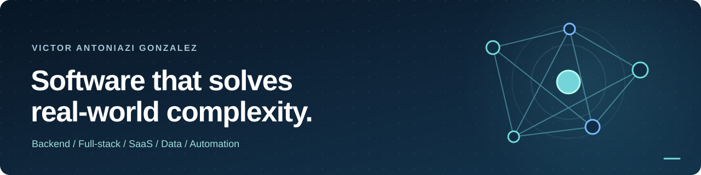

  

<h1 align="center">Victor Antoniazi Gonzalez</h1>

  <strong>Backend &amp; Full-Stack Software Developer | Software Architecture | SaaS | Data &amp; Automation</strong>

  Brazil &amp; Argentina · Building software since 2018 · Portuguese · English · Spanish

  <a href="https://pineapplelab.net/">Website</a> ·
  <a href="./PROJECTS.md">Engineering portfolio</a> ·
  <a href="https://www.linkedin.com/in/victor-antoniazi/">LinkedIn</a> ·
  <a href="https://orcid.org/0000-0001-7577-464X">ORCID</a> ·
  <a href="mailto:victor@petflow.pro">Email</a>

  <strong>English</strong> · <a href="./README.pt-BR.md">Português (Brasil)</a> · <a href="./README.es.md">Español (Argentina)</a>

---

## Software engineering for complex, real-world systems

I'm **Victor Antoniazi Gonzalez**, a backend-focused full-stack developer working across **Brazil and Argentina**. I design, develop and modernize business software: **REST APIs, SaaS platforms, enterprise systems, data-intensive applications, integrations and automation**.

My work connects business requirements to technical delivery — from **SQL schema design and backend services** to **TypeScript/React interfaces, security controls, testing, Docker infrastructure and CI/CD**. I have built personal software projects since **2018** and worked on corporate software projects since **2023–2024**.

Beyond technology, I bring a background in **healthcare and peer-reviewed research**. It has taught me to value reproducibility, accurate data, explicit assumptions and reliable decision-making.

**The problems I enjoy:** complicated workflows, legacy systems that need to evolve, multi-application products, sensitive data, difficult integrations and software that people depend on every day.

## Core expertise

| Area | Engineering experience |
| --- | --- |
| **Backend engineering** | Python, FastAPI, PHP, Node.js, REST APIs, business logic, service and repository layers, asynchronous/background jobs |
| **Full-stack development** | TypeScript, JavaScript, React, component-driven UI, responsive admin panels, complex forms and data-rich interfaces |
| **Software architecture** | API-first design, modular domains, Controller → Service → Repository, legacy modernization, migrations and integration contracts |
| **Data engineering & SQL** | PostgreSQL, MySQL, relational schemas, transactions, query design, data imports/exports, scheduled processing and operational analytics |
| **Security & reliability** | Authentication, RBAC, permissions at resource level, tenant isolation, validation, auditability, idempotency and regression testing |
| **DevOps & delivery** | Git, GitHub, Azure DevOps, Docker, Docker Compose, Nginx, Linux and deployment workflows |
| **AI-assisted development** | Context engineering, implementation assistance, code review, task decomposition, test generation and source-grounded automation |

### Everyday technology stack

  
  
  
  
  
  
  
  
  
  
  
  

Also experienced with **Go, R, Pandas, NumPy, Linux scripting, scientific data analysis and relational database administration**. My tooling depends on the requirements of each system rather than a fixed technology preference.

## Featured engineering work

These are representative **project families and domains**, not a list of invented public repositories or unverifiable impact metrics. Some codebases are private due to intellectual property and client confidentiality.

### 01. Enterprise platforms · operations, compliance & modernization

**Backend / architecture / full stack / security**

I work on enterprise applications where business processes need traceable data and strict access boundaries: **approvals, document workflows, financial and fiscal processes, people and organizational records, operational management, notifications and integrations**.

The engineering challenge is often to modernize existing software without interrupting dependent workflows: disentangling legacy modules, designing API boundaries, preserving data integrity, improving role-based authorization and building repeatable validation and deployment processes.

[Read the enterprise case study →](./PROJECTS.md#01--enterprise-systems-operations-and-compliance)

### 02. [PinePet](https://pinepet.com.br) · pet-business management SaaS

**SaaS / product engineering / business workflows / data modeling**

A product ecosystem for pet shops, grooming services, veterinary operations and related businesses. My development work spans **customers and pets, scheduling, operational workflows, stock, point of sale, account onboarding, permissions, integrations and automation**.

Its architecture brings together relational data, multi-tenant concerns, customer-facing UX and the operational complexity of a growing software product.

[Explore PinePet](https://pinepet.com.br) · [Product engineering details](./PROJECTS.md#02--pinepet-business-management-saas-for-pet-services)

### 03. [Pineapple Lab](https://pineapplelab.net/) · software, integrations & automation

**Independent software business / websites / applications / infrastructure**

I'm the **founder of Pineapple Lab**, where I build software and automation for practical business problems. The broader ecosystem combines a public business presence with supporting services for project operations, contracts, workflow organization, messaging, content processes and infrastructure.

My approach is to prioritize **useful, maintainable automation**, not to add AI where simpler software would work better.

[Visit Pineapple Lab](https://pineapplelab.net/) · [Engineering context](./PROJECTS.md#03--pineapple-lab-software-services-and-operations-platform)

### 04. Healthcare software & scientific data

**Healthtech / operational workflows / data / research**

My interdisciplinary work includes a healthcare staff-scheduling intervention project, research-oriented software experiments and a **2024 peer-reviewed publication** on the economic impact of inpatient falls. It connects software design with domain knowledge, data quality and evidence-based reasoning.

[Healthcare and research projects](./PROJECTS.md#05--healthcare-workflow-software) · [Research and publication](./RESEARCH.md)

**More work:** [PetFlow.PRO — SaaS architecture and iteration](./PROJECTS.md#04--petflowpro-product-iteration-and-architectural-evolution) · [PineLine — research workflow software](./PROJECTS.md#06--pineline-research-workflow-software)

## Selected public work

**[Funny-button](https://github.com/VAntoniazi/Funny-button)** is a small, dependency-free browser experiment in HTML, CSS and JavaScript with pointer/touch interaction and viewport-aware behavior. It is a public example of UI experimentation, **not** a substitute for my enterprise and SaaS portfolio.

[View all public repositories](https://github.com/VAntoniazi?tab=repositories) · [Read the full engineering portfolio](./PROJECTS.md)

> **Why are many repositories private?** Much of my work belongs to enterprise systems, client projects or commercial software with restricted source access. I describe technical responsibilities and project context publicly, but do not publish confidential code, credentials, customer information or proprietary rules.

## Research, healthcare & analytical thinking

**First author:** [*Economic Analysis of Falls in a Private Hospital in Southern Brazil—A Case–Control Study*](https://doi.org/10.1111/ijn.13313)

*International Journal of Nursing Practice* (Wiley), **2024**, 30(6), e13313 · [PubMed](https://pubmed.ncbi.nlm.nih.gov/39431424/) · [ORCID](https://orcid.org/0000-0001-7577-464X)

The matched case-control study investigated the economic impact of inpatient falls using hospital data, accounting for confounding clinical factors. The research experience complements my software work in **health informatics, statistical reasoning, structured datasets and reliable operational systems**.

My academic background includes **Nursing studies at Faculdade Moinhos de Vento**, with activities in healthcare and research alongside software engineering.

[Research methods and publication details →](./RESEARCH.md)

## How I build software

1. **Understand the workflow.** Identify stakeholders, constraints, edge cases, current systems and the real operational problem.
2. **Design clean boundaries.** Separate API contracts, business logic, persistence and UI, with careful backward compatibility for migrations.
3. **Treat security and data integrity as core requirements.** Validate permissions server-side, protect sensitive data and preserve audit trails.
4. **Make delivery reproducible.** Prefer automated checks, documented deployments, meaningful logging and tests targeted at actual risks.
5. **Use AI with engineering judgment.** AI can help research, implement and review; deterministic controls, human validation and source verification remain essential.

I am particularly interested in roles and collaborations involving **backend development, full-stack engineering, SaaS architecture, legacy modernization, complex integrations, data-intensive products and healthtech**.

## Let's connect

**[Professional website](https://pineapplelab.net/) · [LinkedIn](https://www.linkedin.com/in/victor-antoniazi/) · [Engineering portfolio](./PROJECTS.md) · [Research](./RESEARCH.md) · [Email](mailto:victor@petflow.pro)**

Profile languages: English · <a href="./README.pt-BR.md">Português</a> · <a href="./README.es.md">Español</a>. Project descriptions distinguish public, private, active and exploratory work; no artificial activity counters or unsupported performance claims.
